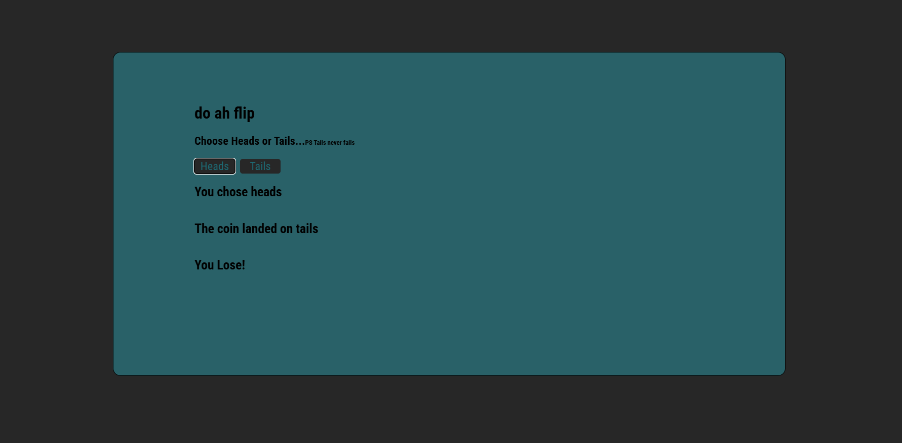

# Coin Flip Guessing Game

A simple coin flip guessing game served by a Node.js server built with the `http` and `fs` modules.
Pick heads or tails, flip the coin, and see if you guessed right.



## Features
- Guess heads or tails
- Random coin flip result on every play
- Tells you whether your guess was right or wrong
- Served from a custom Node server (no frameworks)

## Built With
- Node.js (`http` and `fs` core modules)
- HTML, CSS
- Vanilla ES6 JavaScript 

## Running Locally
1. Clone the repo
2. Make sure [Node.js](https://nodejs.org/) is installed
3. Start the server:
   ```bash
   node server.js
   ```
4. Open `http://localhost:3000` in your browser (or whichever port your server uses)
